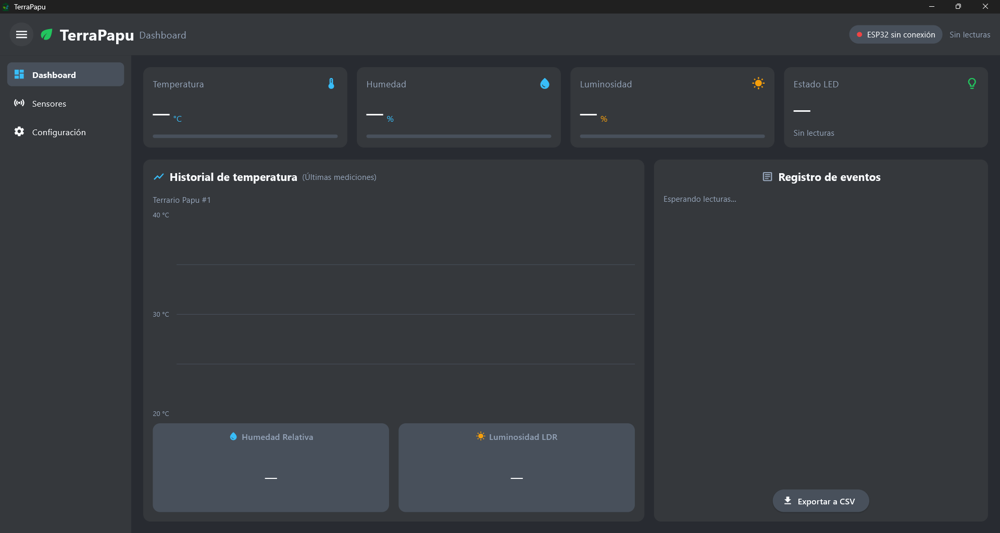
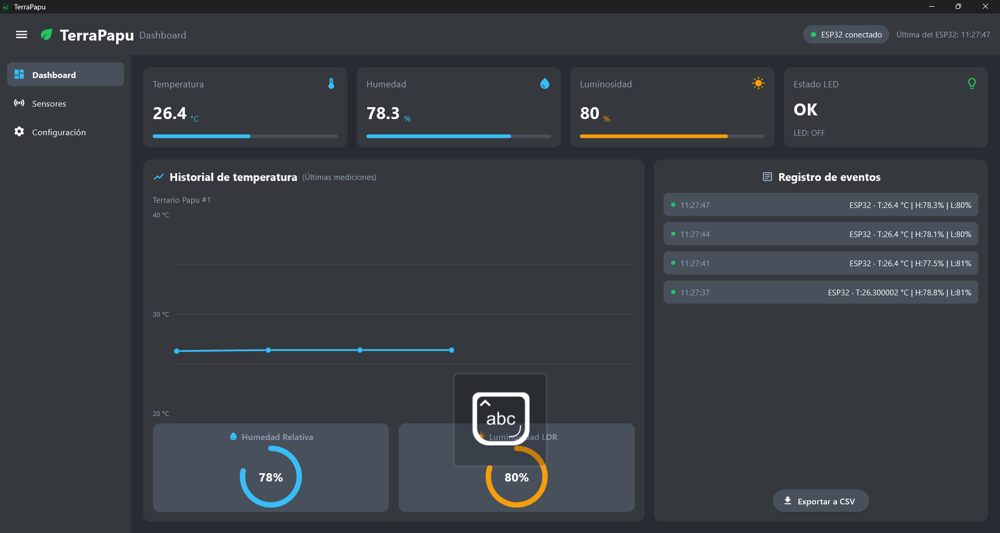
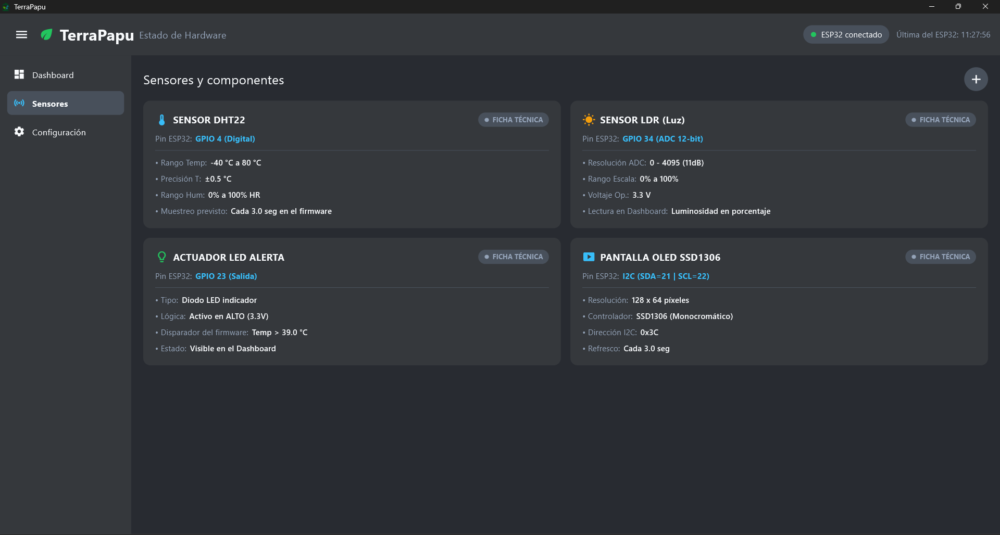
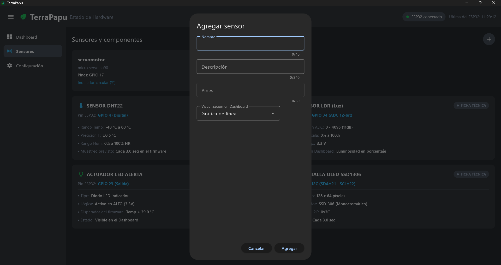
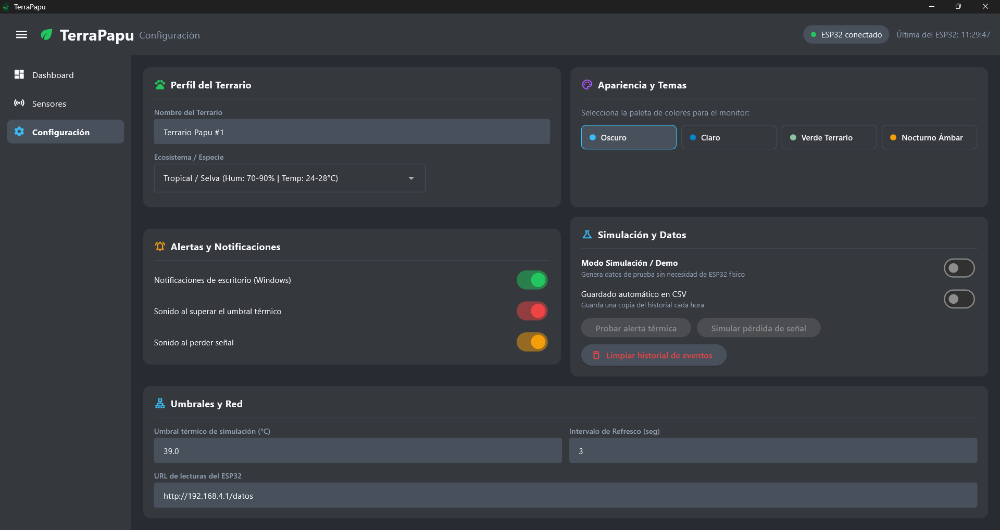

# TerraPapu — Monitor ambiental

TerraPapu es un proyecto universitario para monitorear las condiciones de un terrario. Usa un ESP32 con MicroPython y una aplicación de escritorio hecha en Python con Flet.

## ¿Qué hace?

El ESP32 toma lecturas con un sensor DHT22 y una fotoresistencia LDR. También controla un LED de alerta y muestra información en una pantalla OLED. El LED se activa cuando la temperatura supera los 39 °C.

La interfaz tiene tres vistas: Dashboard, Estado de Hardware y Configuración. En el Dashboard se muestran las tarjetas de temperatura, humedad, luz y estado del LED, además de una gráfica y el registro de eventos.

La simulación arranca apagada. Al encenderla en Configuración, el Dashboard genera lecturas según el ecosistema seleccionado. El intervalo predeterminado es de tres segundos y se puede cambiar junto con el umbral térmico. El simulador actualiza las tarjetas, la gráfica y el registro.

En Configuración se pueden guardar las preferencias y restablecer los valores predeterminados. En Windows se guardan en `%LOCALAPPDATA%/TerraPapu/configuracion.json`. El tema y el ecosistema se aplican al seleccionarlos. Para conservarlos al cerrar, usa **Guardar Configuración**.

Con la simulación activa, **Probar alerta térmica** crea una lectura marcada como prueba. **Simular pérdida de señal** pausa las lecturas hasta que recuperes la señal. Los avisos aparecen dentro de la aplicación y, si se habilitan, Windows puede mostrar una notificación de escritorio y reproducir el sonido configurado.

El registro se puede exportar a CSV manualmente o de forma automática cada hora mientras la aplicación está abierta, si hay lecturas nuevas. Cada archivo se guarda en `exports/` con fecha y hora. **Limpiar historial** borra los eventos y la gráfica de la sesión. Los CSV ya exportados se conservan. Git ignora esa carpeta.

En **Sensores**, el botón **+** permite crear una ficha con nombre, descripción, pines y tipo de visualización. Las fichas agregadas se pueden editar o eliminar desde sus propios botones. Los cambios se guardan localmente y se reflejan arriba en el Dashboard. Las lecturas visibles se muestran con un decimal como máximo.

## Capturas

### Dashboard



### Dashboard conectado al ESP32



### Sensores y componentes



### Formulario de sensores



### Configuración



## Hardware

- ESP32 con MicroPython.
- DHT22: temperatura y humedad, conectado al GPIO 4.
- LDR: luminosidad, conectado al GPIO 34 (ADC).
- LED de alerta: conectado al GPIO 23; se activa sobre 39 °C.
- Pantalla OLED SSD1306 por I2C: SDA en GPIO 21 y SCL en GPIO 22.

## Conectar el ESP32 y la interfaz

1. Con MicroPython instalado en la placa, copia los cinco archivos de `hardware/` a la raíz del sistema de archivos del ESP32 y reinícialo.
2. Desde el portátil, conéctate a la red Wi-Fi **TerraPapu**. La contraseña de demostración es `TerraPapu-ESP32`. Se puede cambiar en `hardware/config_wifi.py`.
3. Abre `http://192.168.4.1/datos` en el navegador. La red del ESP32 suele aparecer como «sin Internet», pero sirve para comunicarse con la placa.
4. Abre la interfaz y deja desactivado el modo simulación. En Configuración puedes revisar la URL o guardarla si cambiaste la dirección. Cuando llegue una lectura válida aparecerá **ESP32 conectado**.

El ESP32 toma una medición cada tres segundos y responde a `GET /datos` con la medición más reciente. El identificador cambia con cada muestra y con cada reinicio de la placa. Flet lo usa para evitar duplicados. Si la placa aún no tiene una medición reciente, devuelve HTTP 503. Si la conexión se pierde, el Dashboard conserva la última lectura con la hora a la que llegó al portátil.

Los sensores agregados desde el botón **+** siguen siendo de prueba. La conexión física utiliza DHT22, LDR y LED. El umbral editable se usa en la simulación y el LED físico sigue la regla de 39 °C del firmware.

```json
{
  "temperatura": 25.4,
  "humedad": 60.0,
  "luz": 80,
  "led": "OK",
  "id_lectura": "62a1375ade8a0110-1"
}
```


## Estructura

```text
hardware/
  main.py                 # Ciclo principal del ESP32
  config.py               # Sensores, actuadores y OLED
  config_wifi.py          # Red Wi-Fi propia del ESP32
  servidor_http.py        # Publica la última medición en /datos
  ssd1306.py              # Controlador de la pantalla OLED

interfaz/
  ventana-principal.py    # Inicio y organización de las vistas
  services/
    simulador.py          # Generación de lecturas de prueba
    registro_eventos.py   # Historial y exportación CSV
    preferencias.py      # Validación y almacenamiento local de la configuración
    alertas.py           # Avisos de escritorio y sonido en Windows
    recibir_datos.py      # Consulta HTTP y validación de lecturas del ESP32
  ui/
    configuracion.py      # Vista de configuración
    sensores.py           # Vista de componentes del hardware
    eventos.py            # Registro visual de lecturas y alertas
    graficas.py           # Gráfica e indicadores circulares
    estilos.py            # Colores y temas

exports/                  # CSV generados; Git ignora esta carpeta
README.md
```
